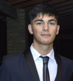

# Ignacio Vendrell

[BLUE TEAM / SECURITY STUDENT]

Estudiante de Tecnicatura Universitaria en Ciberseguridad, interesado en seguridad defensiva y operaciones SOC.

## Áreas de interés

  <article class="profile-card">
    DEFENSIVE OPERATIONS
    <h3>Blue Team y SOC</h3>
    

      BLUE TEAM
      SOC
      HARDENING
    

  </article>
  <article class="profile-card">
    SYSTEMS / PRACTICE
    <h3>Plataformas y práctica</h3>
    

      LINUX
      PYTHON
      CTF
    

  </article>

## Redes

- GitHub: https://github.com/nachove24

## Laboratorios

Próximamente...
