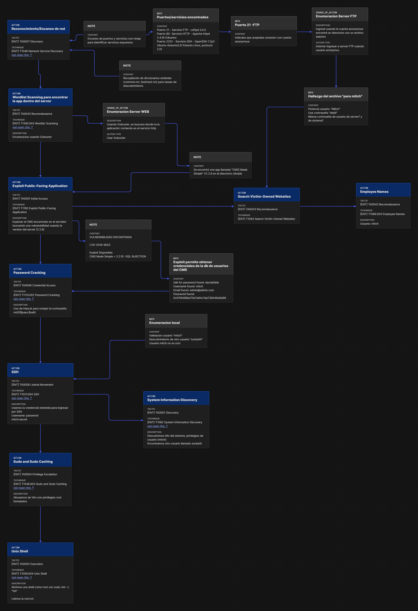

# Pedro | Cyber Risk - Blue Team 

> Analista en Ciberseguridad orientado a la defensa activa, gobernanza, normativas y gestión de riesgos informáticos (Cyber Risk Insurance). Interesado en la convergencia entre el análisis técnico de amenazas y la responsabilidad legal.

\---

##### 🎯 Perfil/Áreas de Interés

* Cyber Risk \& Aspectos Legales: Transferencia de riesgo, pólizas de ciberriesgo, cumplimiento normativo y marcos de gobernanza (GRC).
* Blue Team \& Análisis Técnico: Respuesta a incidentes, análisis forense de tráfico de red y detección de malware / ransomware.
* Investigación \& Hardware: OSINT (Inteligencia de Fuentes Abiertas) y Electrónica general aplicada a la seguridad.

\---

##### 🔬 Laboratorios/Casos Prácticos

**1. Bluesky Ransomware — Detección y Forense (CyberDefenders)**

\* Categoría: DFIR / Análisis de Malware

\* Objetivo: Investigación de un incidente provocado por el ransomware Bluesky, analizando evidencias de ejecución, mecanismos de persistencia y artefactos en el sistema impactado.

\* Habilidades aplicadas: Análisis de logs, identificación de indicadores de compromiso (IoCs) y alcance de cifrado.

\---

**2. Packet Maze — Análisis Forense de Red (CyberDefenders)**

\* Categoría: Network Forensics / Wireshark

\* Objetivo: Inspección de capturas de tráfico (`.pcap`) para reconstruir comunicaciones maliciosas, extracción de payloads y detección de exfiltración de datos.

\* Habilidades aplicadas: Protocolos de red (TCP/UDP, HTTP, DNS), filtrado avanzado en Wireshark y reconstrucción de sesiones.

\---

**3. Simple CTF — Análisis y Mapeo MITRE ATT\&CK (TryHackMe)**

\* Categoría: Threat Modeling y/ Pentesting básico

\* Objetivo: Explotación controlada y análisis de la cadena del ataque a través de la metodología MITRE ATT\&CK para comprender la perspectiva del adversario (Red to Blue).

<h4>🗺️ Flujo Completo del Ataque (MITRE ATT\&CK)</h4>

<table border="1">

&#x20; <thead>

&#x20;   <tr>

&#x20;     <th>Fase del Ataque</th>

&#x20;     <th>Táctica (MITRE)</th>

&#x20;     <th>Técnica ID</th>

&#x20;     <th>Descripción del Evento / Herramienta</th>

&#x20;   </tr>

&#x20; </thead>

&#x20; <tbody>

&#x20;   <tr>

&#x20;     <td><b>Reconocimiento</b></td>

&#x20;     <td>Reconnaissance</td>

&#x20;     <td><code>T1595</code></td>

&#x20;     <td>Escaneo de puertos y servicios con Nmap (FTP, HTTP, SSH)</td>

&#x20;   </tr>

&#x20;   <tr>

&#x20;     <td><b>Búsqueda de Nombres</b></td>

&#x20;     <td>Reconnaissance</td>

&#x20;     <td><code>T1589.002</code></td>

&#x20;     <td>Obtención del nombre de usuario objetivo (mitch)</td>

&#x20;   </tr>

&#x20;   <tr>

&#x20;     <td><b>Enumeración Web</b></td>

&#x20;     <td>Reconnaissance</td>

&#x20;     <td><code>T1595.003</code></td>

&#x20;     <td>Fuzzing con Gobuster para descubrir directorio /simple (CMS Made Simple)</td>

&#x20;   </tr>

&#x20;   <tr>

&#x20;     <td><b>Explotación Web</b></td>

&#x20;     <td>Initial Access</td>

&#x20;     <td><code>T1190</code></td>

&#x20;     <td>Explotación de vulnerabilidad SQL Injection (CVE-2019-9053) en el CMS</td>

&#x20;   </tr>

&#x20;   <tr>

&#x20;     <td><b>Cracking de Contraseñas</b></td>

&#x20;     <td>Credential Access</td>

&#x20;     <td><code>T1110.002</code></td>

&#x20;     <td>Uso de Hashcat para obtener la contraseña del hash extraído de la BD</td>

&#x20;   </tr>

&#x20;   <tr>

&#x20;     <td><b>Acceso Vía SSH</b></td>

&#x20;     <td>Lateral Movement</td>

&#x20;     <td><code>T1021.004</code></td>

&#x20;     <td>Conexión remota por SSH utilizando credenciales obtenidas (mitch)</td>

&#x20;   </tr>

&#x20;   <tr>

&#x20;     <td><b>Descubrimiento de Sistema</b></td>

&#x20;     <td>Discovery</td>

&#x20;     <td><code>T1082</code></td>

&#x20;     <td>Enumeración local de información del sistema y descubrimiento de usuario sunbath</td>

&#x20;   </tr>

&#x20;   <tr>

&#x20;     <td><b>Escalado de Privilegios</b></td>

&#x20;     <td>Privilege Escalation</td>

&#x20;     <td><code>T1548.003</code></td>

&#x20;     <td>Abuso de Sudo y Sudo Caching (ejecución de vim con privilegios root)</td>

&#x20;   </tr>

&#x20;   <tr>

&#x20;     <td><b>Obtención de Shell Root</b></td>

&#x20;     <td>Execution</td>

&#x20;     <td><code>T1059.004</code></td>

&#x20;     <td>Spawneo de una Unix Shell interactiva como usuario root para leer root.txt</td>

&#x20;   </tr>

&#x20; </tbody>

</table>

 

 

\---

##### 🛠️ Herramientas/Entornos

\- Análisis \& Detección: Wireshark, CyberChef, herramientas OSINT.

\- Marcos \& Metodologías: MITRE ATT\&CK, Gestión de Riesgos Cyber.

