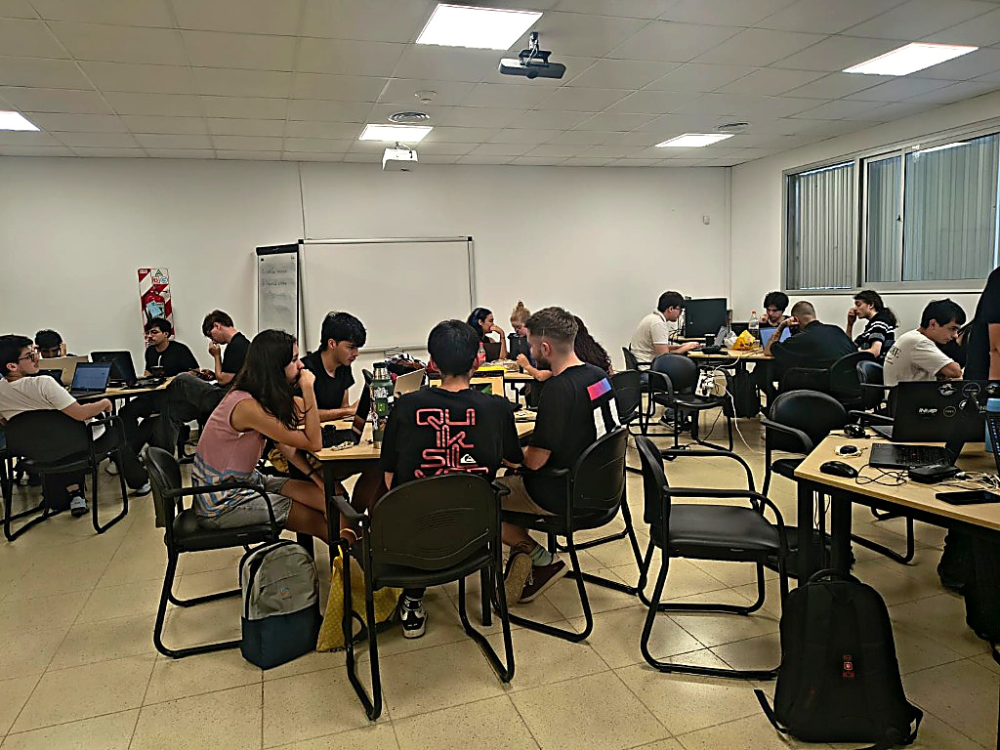

<div style="text-align: center; margin-bottom: 1.75rem;">
  
</div>

<h1>Peluc4s to the <span class="title-highlight">Moon</span></h1>

<div class="tech-pills" style="margin-bottom: 1.5rem; gap: 0.45rem;">
  <span class="tech-pill">FASTAPI</span>
  <span class="tech-pill">PYTHON</span>
  <span class="tech-pill">PYDANTIC</span>
  <span class="tech-pill">CURL</span>
  <span class="tech-pill">PIP-AUDIT</span>
  <span class="tech-pill">BANDIT</span>
  <span class="tech-pill">SEMGREP</span>
  <span class="tech-pill">OWASP TOP 10</span>
  <span class="tech-pill">DEVSECOPS</span>
  <span class="tech-pill">NASA POWER API</span>
  <span class="tech-pill">RENDER</span>
  <span class="tech-pill">GITHUB ACTIONS</span>
</div>

Durante el Space Apps Challenge nos propusimos resolver un problema real usando las APIs de la NASA. Como estudiantes de ciberseguridad (Universidad Provincial de Córdoba), decidimos aprovechar la ocasión para practicar algo que suele quedar en segundo plano: diseñar software pensando en la seguridad desde el principio, no como un paso posterior.

Para avanzar más rápido con el desarrollo, usamos asistentes de IA para generar parte del código. Nos interesaba saber qué tan seguro era ese código cuando lo pedíamos de la forma más habitual: describiendo las funcionalidades que queríamos en la aplicación, sin incluir requisitos de seguridad en los prompts.

Trabajamos con Gemini Flash en VS Code y Antigravity. Al auditar el código generado con herramientas de seguridad como **pip-audit** (análisis de dependencias), **Bandit** (SAST en Python), **Semgrep** (detección de DOM XSS) y pruebas dinámicas con **curl**, identificamos múltiples vulnerabilidades. En las siguientes secciones mostramos cada una: el código tal como apareció, por qué representaba un riesgo y cómo lo corregimos.

<div class="lab-grid">
<article class="lab-card">
<span class="badge">CHALLENGE</span>
<div class="lab-header">
<h3>Problema Oficial</h3>
</div>
<p class="lab-goal">Desafío global de la NASA para la adaptación de cultivos y gestión agroclimática mediante datos satelitales.</p>

<a href="https://www.spaceappschallenge.org/2026/challenges/adapting-farms-with-nasa-data/" target="_blank" rel="noopener" style="display: inline-flex; align-items: center; gap: 0.5rem; margin-top: auto; padding: 0.45rem 0.85rem; color: #38bdf8; background: rgba(56, 189, 248, 0.08); border: 1px solid rgba(56, 189, 248, 0.3); border-radius: 4px; font-family: 'JetBrains Mono', monospace; font-size: 0.78rem; text-decoration: none; width: fit-content;">
<span>Adapting Farms with NASA Data ↗</span>
</a>
</article>

<article class="lab-card">
<span class="badge">REPOSITORY</span>
<div class="lab-header">
<h3>Solución Técnica</h3>
</div>
<p class="lab-goal">Implementación completa, algoritmos de rotación de cultivos y mitigaciones de seguridad.</p>

<a href="https://github.com/PELUC4S/FieldShift" target="_blank" rel="noopener" style="display: inline-flex; align-items: center; gap: 0.55rem; margin-top: auto; padding: 0.45rem 0.85rem; color: #38bdf8; background: rgba(56, 189, 248, 0.08); border: 1px solid rgba(56, 189, 248, 0.3); border-radius: 4px; font-family: 'JetBrains Mono', monospace; font-size: 0.78rem; text-decoration: none; width: fit-content;">
<svg width="16" height="16" viewBox="0 0 24 24" fill="currentColor" style="flex-shrink: 0;"><path d="M12 0C5.37 0 0 5.37 0 12c0 5.31 3.435 9.795 8.205 11.385.6.105.825-.255.825-.57 0-.285-.015-1.23-.015-2.235-3.015.555-3.795-.735-4.035-1.41-.135-.345-.72-1.41-1.23-1.695-.42-.225-1.02-.78-.015-.795.945-.015 1.62.87 1.845 1.23 1.08 1.815 2.805 1.305 3.495.99.105-.78.42-1.305.765-1.605-2.67-.3-5.46-1.335-5.46-5.925 0-1.305.465-2.385 1.23-3.225-.12-.3-.54-1.53.12-3.18 0 0 1.005-.315 3.3 1.23.96-.27 1.98-.405 3-.405s2.04.135 3 .405c2.295-1.56 3.3-1.23 3.3-1.23.66 1.65.24 2.88.12 3.18.765.84 1.23 1.905 1.23 3.225 0 4.605-2.805 5.625-5.475 5.925.435.375.81 1.095.81 2.22 0 1.605-.015 2.895-.015 3.3 0 .315.225.69.825.57A12.02 12.02 0 0024 12c0-6.63-5.37-12-12-12z"/></svg>
<span>PELUC4S / FieldShift ↗</span>
</a>
</article>
</div>

## Vulnerabilidades encontradas

### 1. Mitigar Vulnerabilidades CORS (Cross-Origin Resource Sharing)

**¿Qué es?**  
CORS es un mecanismo de seguridad implementado por los navegadores que decide qué páginas web externas tienen permiso para consumir tu API.

**El problema en el código anterior:**  
En `backend/main.py` teníamos:
```python
# ❌ VULNERABLE: Comodín total con credenciales activadas
app.add_middleware(
    CORSMiddleware,
    allow_origins=["*"],
    allow_credentials=True,
    allow_methods=["*"],
    allow_headers=["*"],
)
```

**Riesgo:**  
Por estándar oficial W3C/Fetch, un servidor no puede usar `allow_origins=["*"]` y al mismo tiempo `allow_credentials=True`. Los navegadores modernos rechazan esa respuesta. Además, un comodín absoluto (`"*"`) permite que cualquier sitio web malicioso en Internet consuma tu backend sin restricciones.

**La solución implementada:**  
```python
# ✅ PROTEGIDO: Lista blanca de dominios y credenciales desactivadas
ALLOWED_ORIGINS = [
    "https://peluc4s.github.io",
    "https://fieldshift-api.onrender.com",
    "http://localhost:8088",
    "http://127.0.0.1:8088",
]
app.add_middleware(
    CORSMiddleware,
    allow_origins=ALLOWED_ORIGINS,
    allow_origin_regex=r"^https?://(localhost|127\.0\.0\.1)(:\d+)?$|^https://.*\.github\.io$|^https://.*\.onrender\.com$",
    allow_credentials=False,  # La API es pública y stateless (sin cookies de sesión)
    allow_methods=["GET", "POST", "OPTIONS"],
    allow_headers=["Content-Type", "Accept", "Origin", "User-Agent"],
)
```

**Beneficio:**  
Solo tu frontend en GitHub Pages y los entornos locales de desarrollo tienen permiso explícito, bloqueando peticiones no autorizadas desde orígenes sospechosos.

---

### 2. DoS de Almacenamiento (Denial of Service por Agotamiento de Disco/Inodos)

**¿Qué es?**  
Un ataque de Denegación de Servicio (DoS) de almacenamiento ocurre cuando se satura el espacio en disco o el número máximo de archivos (inodos) del sistema operativo, provocando el colapso del servidor.

**El problema en el código anterior:**  
En `backend/main.py`, cada vez que alguien consultaba una coordenada, se guardaba un archivo `.json` de forma infinita:
```python
# ❌ VULNERABLE: Se crea un archivo nuevo sin límite alguno
lat_r, lon_r = round(lat, 2), round(lon, 2)
archivo_cache = CACHE_DIR / f"clima_{lat_r}_{lon_r}.json"
# Si el archivo no existía, se escribía en disco incondicionalmente
archivo_cache.write_text(json.dumps(resultado, ...))
```

**Riesgo:**  
Como la latitud (-90 a 90) y longitud (-180 a 180) con 2 decimales tienen más de 648 millones de combinaciones posibles, un atacante con un script automatizado podía enviar coordenadas arbitrarias y crear cientos de miles de archivos JSON hasta agotar el disco del servidor en Render, tumbando la aplicación.

**La solución implementada:**  
Se programó una función de guardado seguro con política de desalojo LRU (*Least Recently Used*):
```python
# ✅ PROTEGIDO: Cuota máxima de 500 archivos y rotación automática
MAX_CACHE_FILES = 500

def _safe_write_cache(file_path: Path, data: dict[str, Any]) -> None:
    cached_files = list(CACHE_DIR.glob("clima_*.json"))
    if len(cached_files) >= MAX_CACHE_FILES:
        # Si se alcanza el límite, borramos el 10% más viejo para hacer espacio
        cached_files.sort(key=lambda f: f.stat().st_mtime)
        for old_file in cached_files[:max(1, len(cached_files) // 10)]:
            old_file.unlink(missing_ok=True)
           
    file_path.write_text(json.dumps(data, ensure_ascii=False, indent=2), encoding="utf-8")
```

**Beneficio:**  
La carpeta de caché nunca superará los 500 archivos. Si se llena, se borran automáticamente los más antiguos, protegiendo el almacenamiento del servidor.

---

### 3. Sanitización DOM XSS (Cross-Site Scripting Basado en el DOM)

**¿Qué es?**  
Ocurre en el navegador del usuario cuando se toman textos y se insertan directamente en el documento con `.innerHTML`. Si ese texto llega a contener etiquetas HTML como `` o `<script>`, el navegador las ejecuta como código JavaScript.

**El problema en el código anterior:**  
En `frontend/index.html` se interpolaban variables directamente:
```javascript
// ❌ VULNERABLE: Inserción directa en innerHTML sin escapar
card.innerHTML = `
  <div class="crop-name">${formatCropName(name)}</div>
  <div class="tl-succ-badge" title="${cleanText}"></div>
`;
```

**Riesgo:**  
Si un texto agronómico, el nombre de una semilla o un parámetro contenía caracteres especiales (`<`, `>`, `"`), el navegador creaba elementos HTML no deseados y ejecutaba scripts en el navegador del usuario.

**La solución implementada:**  
Creamos una función defensiva `escapeHTML()` que convierte los caracteres peligrosos en entidades HTML seguras:
```javascript
// ✅ PROTEGIDO: Función de escape de caracteres especiales
function escapeHTML(str) {
  if (str == null) return '';
  return String(str)
    .replace(/&/g, '&amp;')
    .replace(/</g, '&lt;')   // Convierte < en &lt; (no ejecutable)
    .replace(/>/g, '&gt;')   // Convierte > en &gt; (no ejecutable)
    .replace(/"/g, '&quot;')
    .replace(/'/g, '&#39;');
}

// Ahora todo dato dinámico pasa primero por escapeHTML:
const safeName = escapeHTML(formatCropName(name));
card.innerHTML = `
  <div class="crop-name">${safeName}</div>
  <div class="tl-succ-badge" title="${escapeHTML(cleanText)}"></div>
`;
```

**Beneficio:**  
Aunque alguien intente inyectar código JavaScript malicioso, el navegador lo mostrará como simple texto plano y nunca lo ejecutará.

---

### 4. Cabeceras HTTP de Seguridad (HTTP Security Headers)

**¿Qué es?**  
Son directivas que el servidor le envía al navegador web en cada respuesta para activar defensas nativas contra ataques de interfaz, engaños de tipos de archivo y robo de información.

**El problema en el código anterior:**  
FastAPI devolvía las respuestas JSON o estáticas sin cabeceras de seguridad, dejando al navegador sin instrucciones explícitas de protección.

**La solución implementada:**  
Se agregó un middleware global en `backend/main.py`:
```python
# ✅ PROTEGIDO: Inyección de cabeceras de seguridad en cada respuesta HTTP
@app.middleware("http")
async def add_security_headers(request: Request, call_next):
    response = await call_next(request)
    response.headers["X-Content-Type-Options"] = "nosniff"
    response.headers["X-Frame-Options"] = "DENY"
    response.headers["Referrer-Policy"] = "strict-origin-when-cross-origin"
    response.headers["X-XSS-Protection"] = "1; mode=block"
    response.headers["Permissions-Policy"] = "camera=(), microphone=(), geolocation=*"
    return response
```

**¿Qué hace cada cabecera?**  
* **`X-Frame-Options: DENY`:** Impide que otra página web incruste a FieldShift dentro de un `<iframe>` invisible para engañar al usuario y capturar clics (Clickjacking).
* **`X-Content-Type-Options: nosniff`:** Obliga al navegador a respetar estrictamente el tipo de archivo declarado (`application/json`) e impide que intente "adivinar" o ejecutar un archivo como script (MIME Confusion Attack).
* **`Referrer-Policy: strict-origin-when-cross-origin`:** Evita que al hacer clic en enlaces externos se filtren rutas privadas o parámetros en la cabecera Referer.
* **`X-XSS-Protection: 1; mode=block`:** Activa el filtro nativo de los navegadores contra ataques de Cross-Site Scripting reflejados.

---

### 5. Limitación de Tasa (Rate Limiting) y Protección contra Bots

**¿Qué es?**  
El Rate Limiting (límite de tasa) y la protección contra bots son mecanismos de control que restringen cuántas peticiones puede realizar una misma dirección IP en una ventana de tiempo, bloqueando además clientes automáticos no autorizados.

**El problema en el código anterior:**  
En `backend/main.py` no existía ningún control de frecuencia ni filtro sobre quién realizaba las peticiones:
```python
# ❌ VULNERABLE: Sin límite de peticiones ni filtro de agentes automáticos
# Cualquier cliente o bot podía enviar miles de peticiones sin restricción
```

**Riesgo:**  
Un atacante, botnet o script automatizado podía enviar miles de peticiones por segundo contra los endpoints de cálculo agroclimático, saturando la CPU y memoria del contenedor gratuito en Render y dejando el servicio inaccesible para los productores reales (Denegación de Servicio o DoS).

**La solución implementada:**  
Se implementó un middleware defensivo en `backend/main.py`:
```python
# ✅ PROTEGIDO: Middleware de Rate Limiting con ventana deslizante y filtro de escáneres
RATE_LIMIT_WINDOW = 60        # Ventana de 60 segundos
RATE_LIMIT_MAX_REQUESTS = 60  # Máximo 60 peticiones/minuto por IP
_request_records = defaultdict(list)
BLOCKED_USER_AGENTS = {
    "sqlmap", "nikto", "masscan", "nmap", "dirbuster", "acunetix", "havij", "zgrab"
}

@app.middleware("http")
async def rate_limiting_and_bot_protection(request: Request, call_next):
    # 1. Bloqueo inmediato de escáneres maliciosos con HTTP 403
    ua = request.headers.get("user-agent", "").lower()
    if any(bot in ua for bot in BLOCKED_USER_AGENTS):
        return Response(content=json.dumps({"detail": "Acceso denegado"}), status_code=403, media_type="application/json")

    # 2. Control de frecuencia por IP (Ventana deslizante)
    forwarded = request.headers.get("x-forwarded-for")
    client_ip = forwarded.split(",")[0].strip() if forwarded else (request.client.host if request.client else "unknown")

    if request.url.path.startswith("/api/") or request.url.path in ["/climate", "/compare"]:
        now = time.time()
        _request_records[client_ip] = [t for t in _request_records[client_ip] if now - t < RATE_LIMIT_WINDOW]
        
        if len(_request_records[client_ip]) >= RATE_LIMIT_MAX_REQUESTS:
            return Response(
                content=json.dumps({"detail": "Demasiadas peticiones. Por favor, reintente en 60 segundos."}),
                status_code=429,
                headers={"Retry-After": "60"},
                media_type="application/json"
            )
        _request_records[client_ip].append(now)

    return await call_next(request)
```

**Beneficio:**  
Evita la saturación del servidor y garantiza la disponibilidad del servicio. Si un usuario o script excede el límite razonable, recibe una respuesta estándar `HTTP 429 Too Many Requests`, y los escáneres maliciosos quedan bloqueados con `HTTP 403 Forbidden`.

---

### 6. Bloqueo de Manipulación de Campos Extra (Mass Assignment / Parameter Tampering)

**¿Qué es?**  
La manipulación de campos (o asignación masiva) sucede cuando un cliente envía en el cuerpo de la petición (JSON) propiedades o campos ocultos que el desarrollador no tenía previstos en el esquema de la API.

**El problema en el código anterior:**  
En `backend/main.py` los esquemas Pydantic utilizaban la configuración por defecto:
```python
# ❌ VULNERABLE: Acepta e ignora silenciosamente parámetros inesperados o inyectados
class Priorities(BaseModel):
    water_availability: int = Field(default=3, ge=1, le=5)
    climate_risk: int = Field(default=3, ge=1, le=5)

class RotationRequest(BaseModel):
    latitude: float = Field(..., ge=-90, le=90)
    longitude: float = Field(..., ge=-180, le=180)
```

**Riesgo:**  
Un atacante puede enviar parámetros arbitrarios (por ejemplo `{"admin": true}` o `{"override": true}`) buscando que el backend almacene o procese variables inesperadas en memoria, propiciando escaladas de privilegios o comportamientos anómalos.

**La solución implementada:**  
Se configuró `model_config = ConfigDict(extra="forbid")` en los modelos Pydantic:
```python
# ✅ PROTEGIDO: Rechazo estricto de cualquier campo adicional con extra="forbid"
class Priorities(BaseModel):
    model_config = ConfigDict(extra="forbid")
    water_availability: int = Field(default=3, ge=1, le=5)
    climate_risk: int = Field(default=3, ge=1, le=5)

class RotationRequest(BaseModel):
    model_config = ConfigDict(extra="forbid")
    latitude: float = Field(..., ge=-90, le=90)
    longitude: float = Field(..., ge=-180, le=180)
    start_month: int = Field(default=10, ge=1, le=12)
    num_cycles: int = Field(default=3, ge=1, le=10)
    first_crop_key: Optional[str] = Field(default=None, max_length=30)
    weights: Optional[dict[str, float]] = Field(default=None)
    previous_crops: Optional[list[str]] = Field(default=None, max_length=5)
```

**Beneficio:**  
Blindaje hermético de los modelos de entrada: cualquier petición que contenga un solo campo no autorizado es rechazada de inmediato con un error **`HTTP 422 Unprocessable Entity`**.

---

### 7. Ocultamiento de Trazas y Datos Internos de Error (Information Disclosure / Stack Trace Leak)

**¿Qué es?**  
La fuga de información en excepciones ocurre cuando el servidor web, ante un error imprevisto en tiempo de ejecución, le devuelve al usuario o cliente el volcado completo de la traza de error (*stack trace*).

**El problema en el código anterior:**  
En `backend/main.py` no existía un capturador global de excepciones:
```python
# ❌ VULNERABLE: Sin captura global; el framework genera respuestas con trazas internas
# Si una función fallaba, FastAPI devolvía un error con nombres de archivos y código fuente
```

**Riesgo:**  
Las trazas de error exponen la arquitectura del servidor: rutas del sistema de archivos (`/Users/florencia/...` o `/opt/render/...`), versiones exactas de paquetes, nombres de variables y fragmentos de código fuente.

**La solución implementada:**  
Se configuró un manejador global de excepciones:
```python
# ✅ PROTEGIDO: Capturador global que guarda la traza en servidor y responde de forma neutra
@app.exception_handler(Exception)
async def generic_exception_handler(request: Request, exc: Exception):
    # El detalle técnico completo se guarda seguro en el log privado del servidor
    logger.error(f"Error interno no controlado en {request.method} {request.url.path}: {exc}", exc_info=True)
    
    # Al cliente externo se le devuelve solo un mensaje limpio y neutral
    return Response(
        content=json.dumps({"detail": "Ocurrió un error interno al procesar su solicitud. Intente nuevamente."}),
        status_code=500,
        media_type="application/json"
    )
```

**Beneficio:**  
Cero fuga de metadatos o código fuente. Los desarrolladores pueden auditar el problema desde los logs privados de Render, mientras los usuarios solo reciben un mensaje limpio con `HTTP 500`.

---

### 8. Desactivación de Swagger / OpenAPI en Producción (Swagger / OpenAPI Exposure)

**¿Qué es?**  
FastAPI genera de forma predeterminada la interfaz gráfica de Swagger (`/docs`), ReDoc (`/redoc`) y el archivo JSON de especificación (`/openapi.json`), los cuales detallan todos los endpoints y formatos de la API.

**El problema en el código anterior:**  
En `backend/main.py` la aplicación se creaba sin verificar si corría en entorno local o de producción:
```python
# ❌ VULNERABLE: Documentación y mapa completo de la API expuestos en la nube
app = FastAPI(
    title="FieldShift API — Predicción de Rotación de Cultivos",
    description="API AgTech basada en NASA POWER.",
    version="1.0.0",
)
```

**Riesgo:**  
Facilita la fase de reconocimiento (*reconnaissance*): cualquier persona o bot en Internet puede inspeccionar en segundos la totalidad de los endpoints y esquemas JSON esperados.

**La solución implementada:**  
Se incorporó una verificación del entorno de ejecución:
```python
# ✅ PROTEGIDO: Detección inteligente de entorno para apagar Swagger en producción
IS_PROD = os.getenv("ENVIRONMENT", "").lower() in ["production", "prod"] or os.getenv("RENDER") == "true"

app = FastAPI(
    title="FieldShift API — Predicción de Rotación de Cultivos",
    docs_url=None if IS_PROD else "/docs",        # Desactiva Swagger UI en producción
    redoc_url=None if IS_PROD else "/redoc",      # Desactiva ReDoc en producción
    openapi_url=None if IS_PROD else "/openapi.json", # Oculta el esquema JSON
)
```

**Beneficio:**  
En desarrollo local se mantiene la documentación interactiva activa para pruebas, pero en el servidor de producción de Render las rutas de Swagger quedan desactivadas respondiendo `404 Not Found`.

---

### 9. Fijación Estricta de Dependencias (Supply Chain Security / Dependency Drift)

**¿Qué es?**  
Ocurre cuando un proyecto especifica dependencias con versiones flotantes o abiertas (usando `>=`), permitiendo que el gestor de paquetes instale versiones no probadas o comprometidas en el siguiente despliegue.

**El problema en el código anterior:**  
En `requirements.txt` se utilizaban operadores flotantes:
```text
# ❌ VULNERABLE: Versiones flotantes con >=
fastapi>=0.100.0
uvicorn[standard]>=0.23.0
requests>=2.28.0
pandas>=2.0.0
numpy>=1.24.0
pydantic>=2.0.0
openpyxl>=3.1.0
```

**Riesgo:**  
Si una de las librerías publica una nueva versión con cambios incompatibles o si un paquete es comprometido en PyPI, el servidor de producción descargará esa versión automáticamente.

**La solución implementada:**  
Fijamos exactamente las versiones auditadas en `requirements.txt`:
```text
# ✅ PROTEGIDO: Fijación exacta y auditada con == (exact pinning)
fastapi==0.162.7
uvicorn[standard]==0.54.0
requests==2.34.2
pandas==3.1.1
numpy==2.5.4
pydantic==2.14.3
openpyxl==3.1.5
```

**Beneficio:**  
Garantiza despliegues 100% deterministas y reproducibles. El servidor instalará única y exclusivamente las versiones probadas y verificadas.

---

### 🛡️ Checklist de los 20 Puntos de Seguridad en FieldShift

<div class="table-scroll" markdown="1">

| # | Ítem de la lista | Aplica | Estado en FieldShift | Detalle técnico y evidencia en el código |
|:---:|---|:---:|:---:|---|
| **1** | **Ocultar API keys** | Sí | ✅ Cumple | FieldShift utiliza APIs públicas de libre acceso (NASA POWER e ISRIC SoilGrids REST) que no requieren clave privada. No hay credenciales expuestas en el código. |
| **2** | **Limpiar secretos de Git** | Sí | ✅ Cumple | El historial y repositorio fueron auditados; `.env` y `.env.local` están estrictamente ignorados en `.gitignore` y no hay tokens rastreados. |
| **3** | **Key pública para DB** | No | ⚪ No Aplica | FieldShift no utiliza base de datos externa tipo Supabase, Firebase o Postgres; los cálculos agronómicos se procesan in-memory y con caché JSON local. |
| **4** | **Row-Level Security (RLS)** | No | ⚪ No Aplica | No hay usuarios con cuentas multi-inquilino ni tablas donde un usuario deba aislarse de otro; es un motor de predicción abierto por lote/coordenadas. |
| **5** | **Encriptar datos sensibles** | Sí | ✅ Cumple | No se recopilan datos personales (PII), tarjetas ni contraseñas. El tráfico hacia el backend y frontend se transmite cifrado bajo HTTPS/TLS forzado (Render y GitHub Pages). |
| **6** | **Forzar autenticación** | No | ⚪ No Aplica | La herramienta está concebida como servicio AgTech público y abierto para productores y evaluadores del desafío NASA Space Apps. |
| **7** | **Restringir acceso a registros** | No | ⚪ No Aplica | No existen registros privados de usuarios. |
| **8** | **Bloquear manipulación de campos** | Sí | 🛡️ Implementado | En `backend/main.py` se configuró `model_config = ConfigDict(extra="forbid")` en todos los modelos Pydantic (`RotationRequest`, `CompareRequest`, `Priorities`), rechazando automáticamente con error HTTP 422 cualquier payload con campos no autorizados (Mass Assignment). |
| **9** | **Proteger session cookies** | Sí | ✅ Cumple | La API es 100% stateless y no emite ni utiliza cookies de sesión. Además, CORS tiene `allow_credentials=False`. |
| **10** | **Hashear contraseñas** | No | ⚪ No Aplica | No existe sistema de usuarios con contraseña. |
| **11** | **Rate limiting** | Sí | 🛡️ Implementado | Se programó un middleware de limitación de tasa (sliding window) en `backend/main.py` fijado en 60 peticiones/minuto por IP, respondiendo con HTTP 429 y cabecera `Retry-After: 60`. |
| **12** | **Protección contra bots** | Sí | 🛡️ Implementado | En el middleware de `backend/main.py` se agregaron filtros que detectan y bloquean con HTTP 403 escáneres maliciosos y bots automatizados conocidos (`sqlmap`, `nikto`, `masscan`, `nmap`, etc.). |
| **13** | **Validar inputs** | Sí | 🛡️ Implementado | Todos los parámetros numéricos y de texto cuentan con validación estricta de límites: latitud [-90, 90], longitud [-180, 180], mes [1, 12], ciclos [1, 10], cultivos previos acotados a 5 elementos y cadenas a un máximo de 30 caracteres. |
| **14** | **Cerrar CORS** | Sí | 🛡️ Implementado | Se eliminó el comodín inseguro `*` y se configuró una lista blanca explícita de orígenes permitidos (`peluc4s.github.io`, Render y localhost) con `allow_credentials=False`. |
| **15** | **Headers de seguridad** | Sí | 🛡️ Implementado | Middleware global activo que inyecta: `X-Content-Type-Options: nosniff`, `X-Frame-Options: DENY`, `Referrer-Policy: strict-origin-when-cross-origin`, `X-XSS-Protection: 1; mode=block` y `Permissions-Policy`. |
| **16** | **Backups automáticos** | Sí | ✅ Cumple | El código fuente, matrices climáticas de referencia (`clima_*.json`) y el catálogo de semillas (`info_semillas.json`) están versionados y respaldados en GitHub en múltiples ramas (`main`, `version2`, `seguridad`). |
| **17** | **Tope de gasto en APIs de IA** | No | ⚪ No Aplica | El motor de predicción es algorítmico y determinista basado en fórmulas agroclimáticas de NASA POWER; no consume APIs de LLM pagas por token (gasto = $0 USD). |
| **18** | **Auditar dependencias** | Sí | 🛡️ Implementado | En `requirements.txt` se fijaron las versiones exactas verificadas (`fastapi==0.162.7`, `uvicorn==0.54.0`, `requests==2.34.2`, etc.) para garantizar construcciones deterministas e inmunes a ataques en la cadena de suministro. |
| **19** | **Errores sin datos internos** | Sí | 🛡️ Implementado | Se configuró un manejador global de excepciones `@app.exception_handler(Exception)` en `backend/main.py`. Si ocurre un fallo imprevisto, se registra en el log interno del servidor pero al cliente se le devuelve únicamente un mensaje genérico sin trazas de código ni rutas de archivos del sistema. |
| **20** | **Sacar admin y debug** | Sí | 🛡️ Implementado | La documentación interactiva de Swagger (`/docs`, `/redoc` y `/openapi.json`) se desactiva automáticamente cuando se detecta el entorno de producción (`ENVIRONMENT=production` o `RENDER=true`), manteniéndola disponible solo para desarrollo local. |

</div>

<figure style="margin: 3rem auto 1.5rem; text-align: center; max-width: 520px;">
  
  <figcaption style="margin-top: 0.75rem; color: var(--mv-muted); font-size: 0.85rem; font-family: 'JetBrains Mono', monospace; letter-spacing: 0.02em; text-align: center;">
    El equipo de Peluc4s
  </figcaption>
</figure>
